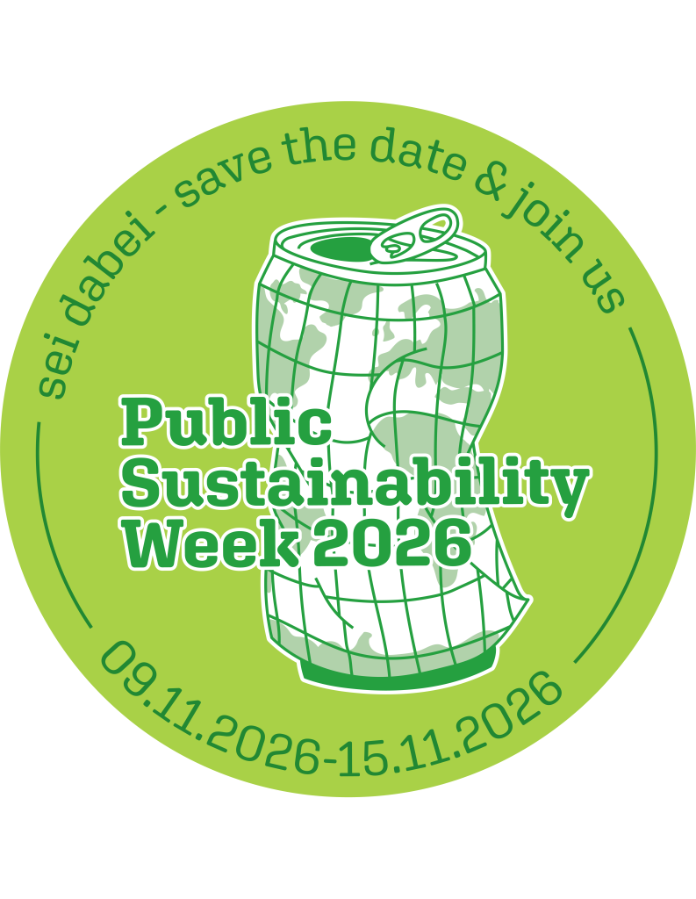

Following its last edition in 2024, Public Sustainability Week is back in Konstanz: **From November 9 to 15, 2026, sustainability will once again become tangible, open to discussion, and—above all—something we can experience together.**
For six days, there will be space for new perspectives, thought-provoking questions, and practical ideas centered on a more sustainable future. Starting Wednesday, we’ll dive into themed days: first, sustainability in general, then its social, ecological, and economic dimensions. Whether you’re already deeply immersed in the topic or simply curious, Public Sustainability Week invites you to contribute your thoughts, join the conversation, and help make Konstanz a little more sustainable.

You can find an overview of all events [on our website](https://www.psw-konstanz.de/).

  <a href="https://www.psw-konstanz.de/">Public Sustainability Week</a>

