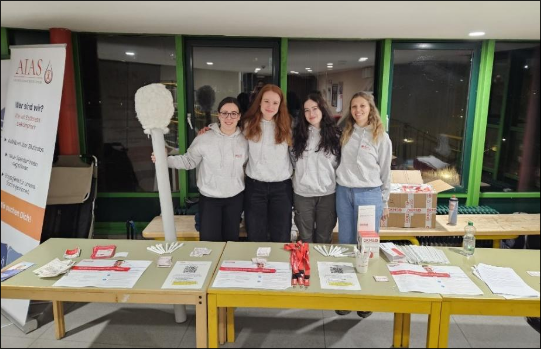
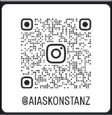

Dear Students,
On **Tuesday, December 8**, you’ll have the chance to make a big difference in just a few minutes:
Come to the **university foyer** and register as a
stem cell donor with DKMS!

Every year, thousands of people are diagnosed with blood cancer. Many of them depend on a
stem cell donation—and maybe **YOU** are the person who can give your
genetic twin a second chance at life.

Signing up is easy:

✅ When? Tuesday, Dec. 8
✅ Where? University lobby
✅ How long? Max. 10 minutes
✅ How? Cheek swab

Why is this important?

• A stem cell donation is often the only chance for a cure for blood cancer.
• Everyone who registers increases the chance of finding a matching donor.

**Be part of the solution and join us!** Every registration counts. Bring your friends
and together let’s take a stand against blood cancer!
We at the **AIAS College Group (Students Against Blood Cancer)** look forward to seeing you
and will be on hand to answer any questions! – Together, we can save lives!

Yours,
AIAS University Group

For more info, check out our Instagram:

