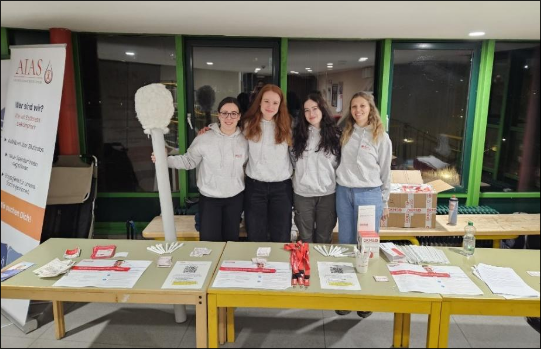
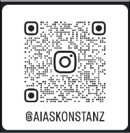

Liebe Studis,
am **Dienstag, den 08. Dezember**, habt ihr die Möglichkeit, innerhalb von wenigen Minuten
etwas Großes zu bewirken: Kommt ins **Foyer der Uni** und registriert euch als
Stammzellspender:in bei der DKMS!

Jedes Jahr erkranken Tausende Menschen an Blutkrebs. Viele von ihnen sind auf eine
Stammzellspende angewiesen – und vielleicht bist **genau DU** die Person, die ihrem
genetischen Zwilling eine zweite Chance auf Leben schenken kann.

Die Registrierung ist einfach:

✅ Wann? Dienstag, 08.12.  
✅ Wo? Foyer der Uni  
✅ Wie lange? Max. 10 Minuten  
✅ Wie? Wangenabstrich

Warum ist das wichtig?

• Eine Stammzellspende ist oft die einzige Heilungschance bei Blutkrebs.  
• Jede:r, der sich registriert, erhöht die Chance, dass ein passende:r Spender:in gefunden wird.

**Werde Teil der Lösung und mach mit!** Jede Registrierung zählt. Bring deine Freunde mit
und setzt gemeinsam ein Zeichen gegen Blutkrebs!
Wir von der **AIAS Hochschulgruppe (Studierende gegen Blutkrebs)** freuen uns auf euch
und stehen bei Fragen vor Ort bereit! – gemeinsam können wir Leben retten!

Eure
AIAS Hochschulgruppe  

Für mehr Infos, schau auf inserem Insta vorbei:  

